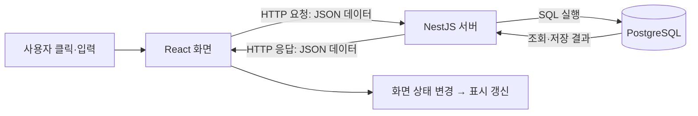
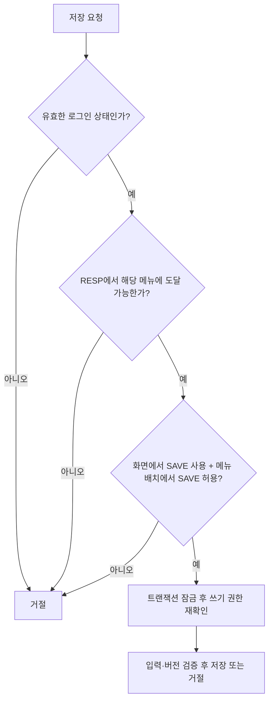
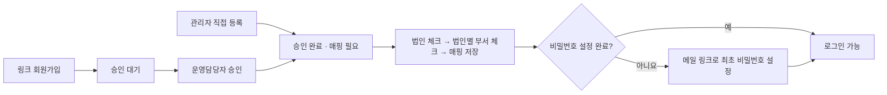

# 대표 동작으로 읽는 Doneline 코드

이 자료는 모든 기능의 명세가 아니라, **화면에서 한 행동이 코드와 DB에 어떻게 이어지는지** 알아보는 입문용 자료입니다. 먼저 1~4절을 읽고 실제 파일에서 같은 함수 이름을 찾아보세요. 예제는 별도 표시가 없으면 현재 코드의 일부이며, 생략한 주변 코드는 원본 파일에서 확인할 수 있습니다.

실행 방법은 [README](README.md), 상세 규칙은 [설계문서](설계문서.md)에 있습니다.

보안 흐름은 **7절**에서 로그인·세션·권한·CSRF·SQL·오류 처리의 대표 사례로 설명합니다.

## 1. 화면 코드와 서버 코드는 어디서 실행될까?

| 위치         | 실행 장소                 | 맡은 일                                   |
| ------------ | ------------------------- | ----------------------------------------- |
| frontend/src | 사용자의 브라우저         | 입력값 기억, 화면 표시, 서버 요청         |
| backend/src  | Node.js 서버              | 로그인·권한 확인, 입력 검증, DB 조회·변경 |
| database     | PostgreSQL에 적용하는 SQL | 테이블·제약·트리거·설명 정의              |



브라우저는 DB에 직접 접속하지 않습니다. `api.ts`가 HTTP 요청을 보내면 서버가 받아 SQL을 실행합니다. 따라서 화면에서 값이 바뀌었다고 DB까지 저장된 것은 아닙니다.

`frontend/index.html`의 `<div id="root">`는 화면이 들어갈 자리입니다. [main.tsx](frontend/src/main.tsx)의 `createRoot(...).render(<App />)`가 그 자리에 로그인 화면과 업무 창틀을 표시합니다. `<App />` 같은 표기는 React 컴포넌트, 즉 화면 조각을 사용하는 JSX 문법입니다. TypeScript에 JSX를 함께 쓰는 파일의 확장자가 `.tsx`입니다.

## 2. 값을 바꾸면 화면은 어떻게 바뀔까?

대표 파일: [RegistrationScreen.tsx](frontend/src/RegistrationScreen.tsx)의 `query` 함수.

```tsx
const [busy, setBusy] = useState(false);
```

이것은 일반 변수 하나를 선언하는 것과 조금 다릅니다.

- `busy`: 현재 렌더에서 읽는 처리 중 여부. 처음에는 false입니다.
- `setBusy(true)`: 값을 바꾸고 React에 화면 갱신을 요청합니다.
- `useState`: 화면을 다시 그려도 이 값을 기억하게 하는 React 함수입니다.
- `[busy, setBusy]`: 반환된 배열의 두 값을 각각 이름 붙여 받는 문법입니다.

실제 조회 흐름을 줄이면 다음과 같습니다. **아래는 설명용 축약 예제입니다.**

```tsx
setBusy(true); // 처리 중 상태로 전환
try {
  const result = await api(url); // 서버 응답을 기다림
  updateRows(result.items.map(wrap)); // 받은 행을 화면 상태에 반영
} catch (error) {
  notify(errorMessage(error), 'error'); // 실패 안내
} finally {
  setBusy(false); // 성공·실패 모두 처리 중 상태 해제
}
```

`async` 함수는 나중에 완료될 결과인 Promise를 반환합니다. `await`는 그 함수 안의 다음 처리를 응답이 올 때까지 기다리게 하며 브라우저 전체를 멈추지는 않습니다. 기다리는 동안에도 화면은 반응할 수 있어 `busy`로 버튼·편집 가능 여부를 제어합니다.

React는 상태에 맞춰 화면을 다시 계산합니다. `setBusy(true)` 직후 같은 함수에서 기존 `busy` 변수를 읽으면 곧바로 true가 된다고 가정하면 안 됩니다. 즉시 읽어야 하는 행 데이터는 다음 절의 ref로 함께 관리합니다.

## 3. 그리드 셀 하나를 수정하면 무슨 일이 생길까?

대표 파일: [DataGrid.tsx](frontend/src/DataGrid.tsx)의 `update`와 [RegistrationScreen.tsx](frontend/src/RegistrationScreen.tsx)의 `updateRows`.

```text
셀 편집 확정
  → onCellEditRequest
  → DataGrid의 update: 행 복사 + 새 값 반영 + 자동 체크
  → onChange(next)
  → 등록 화면의 updateRows
  → setRows로 상태 변경
  → 새 rows를 받은 그리드 표시 갱신
```

부모인 등록 화면이 행 데이터를 소유하고, 자식인 DataGrid에 `rows`로 전달합니다. 이렇게 부모가 전달하는 입력을 **props**라고 부릅니다. 반대로 자식은 부모에게서 받은 `onChange` 함수를 호출해 변경을 알립니다. 이벤트를 받았을 때 실행하도록 전달한 함수를 **콜백**이라고 합니다.

```tsx
const row: GridRow = { ...r, _error: undefined };
```

`...r`은 기존 행의 속성을 복사합니다. 뒤의 `_error: undefined`는 기존 오류 표시를 지웁니다. 기존 객체를 직접 고치는 대신 바뀐 행 객체를 만들어 React에 전달하는 방식입니다. `GridRow`는 이 변수에 들어갈 데이터 모양을 검사하는 타입 이름입니다.

실제 `updateRows`는 두 군데를 갱신합니다.

```tsx
rowRef.current = r;
setRows(r);
```

`setRows`는 화면 갱신용입니다. `rowRef.current`는 화면 갱신을 기다리지 않고 최신 행을 바로 읽기 위한 보관함입니다. `useRef`의 값을 바꾸는 것만으로는 화면이 다시 그려지지 않습니다. 저장 직전에 셀 편집을 확정하고 최신 값을 읽을 때 이 차이가 중요합니다.

| 그리드 옵션                     | 현재 화면에서의 의미                                                                                            |
| ------------------------------- | --------------------------------------------------------------------------------------------------------------- |
| `readOnlyEdit`                  | 편집을 금지한다는 뜻이 아닙니다. 그리드가 데이터를 직접 바꾸지 않고 편집 요청을 보내면 React 쪽에서 변경합니다. |
| `onCellEditRequest`             | 그 편집 요청을 받아 실행할 함수입니다.                                                                          |
| `getRowId`                      | 행 위치 대신 `_key`로 같은 행인지 구분합니다.                                                                   |
| `stopEditingWhenCellsLoseFocus` | 편집 셀에서 포커스가 빠지면 입력을 확정합니다.                                                                  |
| `singleClickEdit={false}`       | 한 번 클릭은 선택, 더블클릭은 편집으로 구분합니다.                                                              |

여기까지는 브라우저 안의 데이터 변경입니다. 상단 저장을 눌러야 다음 단계로 넘어갑니다.

## 4. 저장 버튼부터 DB 확정까지

예시 상황: 화면등록에서 두 행을 체크하고 상단 저장을 누릅니다.

| 순서 | 찾아볼 파일·함수                                                                               | 하는 일                                                                                       |
| ---- | ---------------------------------------------------------------------------------------------- | --------------------------------------------------------------------------------------------- |
| 1    | [main.tsx](frontend/src/main.tsx) → `action`                                                   | 활성 탭의 SAVE 권한과 실행할 함수를 확인합니다.                                               |
| 2    | [RegistrationScreen.tsx](frontend/src/RegistrationScreen.tsx) → `useImperativeHandle`, `batch` | 공개한 save 함수로 들어와 셀 편집 확정, 체크 행 선택, 사용자 확인을 진행합니다.               |
| 3    | [api.ts](frontend/src/api.ts) → `api`                                                          | 행 데이터를 JSON으로 보내고 응답을 받습니다.                                                  |
| 4    | [security.ts](backend/src/security.ts) → `canActivate`                                         | 요청 출처·CSRF·로그인·메뉴별 권한을 확인합니다.                                               |
| 5    | [registration.ts](backend/src/registration.ts) → 컨트롤러 `save`, 서비스 `batch`               | 요청을 업무 함수에 전달하고 입력·버전·쓰기 권한을 검증합니다.                                 |
| 6    | [db.ts](backend/src/db.ts) → `tx`                                                              | SQL과 감사 기록이 모두 성공하면 COMMIT, 오류가 나면 ROLLBACK합니다.                           |
| 7    | 프런트 `batch`의 응답 처리                                                                     | 성공 후 재조회하여 전체를 DB 값으로 교체합니다. 실패하면 오류를 표시하고 편집값을 유지합니다. |

공통 툴바는 등록 화면 내부의 함수를 바로 알지 못합니다. `useImperativeHandle`이 부모에게 `query`, `reset`, `save` 같은 호출 창구를 공개하고, `main.tsx`가 활성 탭의 창구를 찾아 호출합니다.

```tsx
leftGrid.current?.stop();
const chosen = rowRef.current.filter((r) => r._checked);
```

`?.`는 그리드가 연결된 경우에만 `stop()`을 호출하게 합니다. `filter`는 조건이 참인 행만 새 배열로 골라냅니다. 이 예에서는 첫 열에 체크된 행이 저장 대상입니다.

`JSON.stringify(...)`는 행 객체를 전송할 JSON 문자열로 바꿉니다. `fetch(...)`가 네트워크 요청을 보내고, `res.json()`은 응답 본문을 다시 JavaScript 값으로 읽습니다. HTTP 오류 상태는 `api.ts`가 직접 확인해 `ApiError`로 던지므로 화면의 `catch`가 처리할 수 있습니다.

서버에서는 아래 선언이 요청 주소와 함수를 연결합니다.

```ts
@Post(':kind/save')
```

`@Post`처럼 `@`로 시작하는 표기를 **데코레이터**라고 합니다. NestJS에 이 함수의 역할을 알려줍니다. 컨트롤러의 기본 경로 `api/registration`과 합쳐지므로 화면등록 저장 주소는 `/api/registration/screens/save`가 됩니다. `:kind` 자리에 들어온 `screens`는 처리할 등록 종류입니다.

두 행 중 첫 번째 SQL이 성공해도 두 번째가 실패하면 전체 트랜잭션을 취소합니다. 따라서 첫 번째만 저장된 상태로 남지 않습니다. 감사 성공 기록도 같은 트랜잭션에 포함됩니다.

단, DB 저장 후 별도로 수행하는 메뉴 새로고침 실패는 이미 확정된 DB 저장을 취소하지 않습니다. **하나의 트랜잭션 범위**와 **여러 HTTP 요청의 범위**는 다릅니다.

## 5. 알아두면 코드를 읽기 쉬운 짧은 표현

| 표현                           | 읽는 방법                                  | 이 프로젝트에서 쓰는 곳                                      |
| ------------------------------ | ------------------------------------------ | ------------------------------------------------------------ |
| `r => r._checked`              | 행 r을 받아 체크 여부를 반환하는 함수      | 처리 대상 선택                                               |
| `rows.map(wrap)`               | 각 행에 wrap을 적용한 새 배열              | 서버 행에 UI 식별자·체크 상태 추가                           |
| `rows.some(r => r._checked)`   | 체크된 행이 하나라도 있는가                | 탭의 변경 상태 표시                                          |
| `{ ...row, name: value }`      | 기존 속성을 복사하고 name을 교체           | 편집 결과 반영                                               |
| `remove ? '/delete' : '/save'` | remove가 참이면 앞 값, 아니면 뒤 값        | 요청 주소 선택                                               |
| `value                         |                                            | ''`                                                          | 값이 빈 문자열·null·undefined·false·0 등 거짓으로 취급되면 빈 문자열 사용 | 표시 기본값 |
| `error instanceof ApiError`    | 이 오류가 ApiError 종류인가                | 서버의 행별 오류 구분                                        |
| `req.actor!.id`                | actor가 있다고 개발자가 타입 검사기에 보장 | 로그인 가드를 거친 서버 처리. ! 자체는 실행 시 검사하지 않음 |
| `Promise<void>`                | 나중에 완료되지만 반환 데이터는 없는 작업  | 비동기 조회·실행 함수의 타입                                 |
| `Record<string, T>`            | 문자열 이름으로 T 타입 값을 찾는 객체      | 동작 코드별 권한·화면 정의                                   |

처음부터 문법을 모두 외울 필요는 없습니다. 긴 표현을 만나면 **어떤 값을 받아서 → 무엇을 바꿔 → 어디로 넘기는지** 세 가지를 먼저 확인해 보세요.

## 6. 직접 따라 읽는 순서

개발 DB 데이터를 변경하지 않고도 코드를 먼저 따라갈 수 있습니다.

1. `RegistrationScreen.tsx`에서 `query`를 찾고 `setBusy`, `await api`, `updateRows`, `finally`를 읽습니다.
2. `DataGrid.tsx`에서 `onCellEditRequest`를 찾고 `update` → `onChange`의 연결을 읽습니다.
3. 다시 등록 화면의 `batch`를 열어 체크 행 선택과 JSON 요청 생성을 읽습니다.
4. 서버 `RegistrationService.batch`에서 입력 검사 → 버전 비교 → SQL → 감사 기록을 찾습니다.
5. `Db.tx`에서 BEGIN, COMMIT, ROLLBACK의 위치를 확인합니다.

이 다섯 군데를 연결하면 다른 조회·저장 기능도 비슷한 구조로 읽을 수 있습니다. 실제 저장을 연습할 때는 테스트 DB 환경을 사용합니다.

## 7. 보안 검사는 왜 필요하고 어디서 동작할까?

이 절은 현재 코드에 구현된 대표 검사를 설명합니다. 먼저 **인증은 누구인지 확인**, **권한 검사는 그 사람이 이 작업을 해도 되는지 확인**하는 과정으로 구분해 읽으면 좋습니다.

### 7-1. 로그인: 비밀번호를 그대로 저장하지 않는 이유

대표 파일: [auth.ts](backend/src/auth.ts)의 `login`, `changePassword`.

DB에 비밀번호 원문을 저장하면 DB 내용이 노출될 때 비밀번호도 바로 드러납니다. 현재 코드는 Argon2로 만든 해시를 저장하고, 로그인 입력이 그 해시에 맞는지 검사합니다. 해시는 비밀번호를 나중에 복원해 읽으려는 암호화와 목적이 다릅니다.

```ts
const hash = await argon2.hash(body.newPassword);
```

이것은 비밀번호 변경 때 저장할 해시를 만드는 코드입니다. 로그인에서는 `argon2.verify(...)`로 입력을 검증합니다. 해시가 있더라도 추측을 통한 공격 가능성이 사라지는 것은 아니므로 로그인 시도 제한도 함께 사용합니다.

```text
로그인 입력 검증
  → 계정·IP별 시도 횟수 확인
  → 비밀번호 해시 검증 + 사용자·RESP 활성 여부 확인
  → 로그인 전 세션 ID 교체
  → 로그인 세션과 성공 감사 기록 저장
```

없는 계정도 임시 해시를 대상으로 검증하고, 없는 계정과 틀린 비밀번호에 같은 안내를 사용합니다. 응답 메시지나 처리 시간 차이로 계정 존재 여부를 알아내기 어렵게 하려는 처리입니다.

현재 제한 창은 15분이고 계정 기준 5회, IP 기준 30회를 넘으면 거절합니다. 실패만 따로 세는 방식이 아니라 검증 전에 시도 횟수를 올리며, 로그인 성공 후 계정 기준 카운터는 지웁니다. IP 기준 카운터는 성공해도 유지합니다.

### 7-2. 세션: 매번 비밀번호를 보내지 않고 로그인 상태 기억하기

대표 파일: [app.ts](backend/src/app.ts)의 세션 설정, [session-store.ts](backend/src/session-store.ts)의 `get`, `set`, `activity`.

**세션**은 서버가 기억하는 로그인 상태이고 **쿠키**는 브라우저가 해당 서버 요청에 함께 보내는 작은 값입니다. 이 프로젝트의 `doneline.sid` 쿠키에는 세션 식별자가 들어가며, 서버가 그 식별자로 DB 세션을 찾아 사용자를 확인합니다. 업무 요청마다 비밀번호를 다시 보내지 않습니다.

세션 식별자는 로그인 상태를 사용하는 열쇠이므로 보호해야 합니다. DB 조회 키에는 원문 식별자 대신 SHA-256 해시를 사용합니다. 이것은 비밀번호 저장에 쓰는 Argon2와 용도가 다릅니다.

| 쿠키 옵션                     | 현재 의미와 이유                                                                                             |
| ----------------------------- | ------------------------------------------------------------------------------------------------------------ |
| `httpOnly: true`              | 브라우저 JavaScript에서 쿠키 값을 직접 읽지 못하게 합니다. 쿠키를 동반한 요청 자체까지 막는 옵션은 아닙니다. |
| `sameSite: 'lax'`             | 다른 사이트에서 시작된 요청에 쿠키가 전송되는 경우를 제한합니다. 아래 CSRF 검사도 함께 사용합니다.           |
| `secure: settings.production` | 운영 모드에서는 HTTPS 연결로만 쿠키를 전송하게 합니다. 로컬 HTTP 개발 모드에서는 꺼져 있습니다.              |
| `maxAge: settings.absoluteMs` | 쿠키의 유효 시간을 정합니다. 서버는 DB의 만료·폐기 상태도 별도로 검사합니다.                                 |

현재 유휴 제한은 30분, 절대 제한은 발급 후 8시간입니다. 사용자 활동 요청은 유휴 기한을 연장하지만 8시간을 넘겨 연장하지는 않습니다. 일반 조회 요청에 따른 자동 `touch`는 시간을 늘리지 않도록 구현돼 있습니다.

예를 들어 계속 작업하고 있어도 발급 후 8시간이 지나면 세션이 만료됩니다. 로그아웃하면 폐기 시각을 기록하며, 사용자의 비밀번호·RESP·활성 상태가 바뀌면 [DB 트리거](database/002_backend.sql)가 기존 세션을 폐기합니다. 서버의 `get`은 만료·폐기·계정 상태를 확인하므로 브라우저에 쿠키가 남아 있다는 이유만으로 접근을 허용하지 않습니다.

### 7-3. 권한: 저장 버튼을 숨겼는데 서버에서도 검사하는 이유

대표 파일: [security.ts](backend/src/security.ts)의 `canActivate`, [permissions.ts](backend/src/permissions.ts)의 `allows`, [registration.ts](backend/src/registration.ts)의 `lock`.

버튼을 숨기는 것은 사용자에게 가능한 작업을 안내하는 화면 처리입니다. 브라우저를 거치지 않고 API를 직접 요청할 수도 있으므로, 실제 허용 여부는 서버에서 결정해야 합니다.

예를 들어 조회만 허용된 사용자가 저장 API를 직접 호출해도 서버가 SAVE 권한을 검사해 거절합니다. 요청의 `X-Menu-ID`는 어떤 메뉴에서 작업하는지 알려주는 값일 뿐, 그 자체가 권한 증명은 아닙니다.



그림은 권한 관련 단계만 뽑은 것입니다. 실제 변경 요청은 출처와 CSRF도 먼저 검사합니다. 메뉴·화면·사용자·RESP의 활성 상태도 확인합니다.

권한 계산 결과는 메모리에 캐시하지만 DB의 전역 권한 버전이 달라지면 다시 계산합니다. 등록 쓰기는 요청 도중 권한이 바뀌는 경우까지 고려해 잠금을 얻은 후 DB에서 재검사합니다. 메뉴의 `hidden`은 표시 설정이므로 숨김만으로 API 권한이 없어지지는 않습니다.

### 7-4. CSRF·출처: 다른 사이트에서 유도한 변경 요청 구분하기

대표 파일: [auth.ts](backend/src/auth.ts)의 `csrf`, [api.ts](frontend/src/api.ts), [security.ts](backend/src/security.ts).

브라우저는 조건이 맞는 요청에 쿠키를 자동으로 붙입니다. 사용자가 다른 사이트를 보는 중 그 사이트가 우리 서버로 변경 요청을 유도하면, 서버가 로그인 쿠키만 보고 사용자의 의도라고 오해할 수 있습니다. 이런 종류의 문제를 **CSRF(사이트 간 요청 위조)**라고 부릅니다.

현재 코드는 GET·HEAD·OPTIONS를 제외한 요청에서 두 가지를 검사합니다.

| 검사      | 어떤 값을 비교하나?                                                                                            |
| --------- | -------------------------------------------------------------------------------------------------------------- |
| Origin    | 요청의 출처와 서버의 `APP_ORIGIN` 설정이 같은지 확인합니다. 출처에는 주소의 프로토콜·호스트·포트가 포함됩니다. |
| CSRF 토큰 | 세션에 보관한 임의 값과 요청 헤더 `X-CSRF-Token`이 같은지 확인합니다.                                          |

```text
화면이 /api/auth/csrf 호출
  → 서버가 세션에 토큰을 보관하고 응답
  → api.ts가 토큰을 메모리에 기억
  → 로그인·저장 요청 헤더에 토큰 포함
  → 서버가 현재 세션 토큰과 비교
```

로그인 성공 시 세션과 토큰을 새로 발급하고 프런트도 응답의 토큰으로 갱신합니다. 로그인 API의 `@Public()`은 로그인 요구를 생략한다는 뜻이며, 변경 요청의 Origin·CSRF 검사까지 생략하지 않습니다.

여기서 CSRF 토큰은 비밀번호나 메뉴 권한을 대신하지 않습니다. 출처 검사·CSRF·인증·권한은 서로 다른 조건을 확인합니다. 프런트 개발 서버의 포트가 바뀌었는데 `APP_ORIGIN`을 그대로 두면 정상 요청도 출처 검사에서 거절될 수 있습니다.

### 7-5. 입력과 SQL: 입력값이 명령으로 해석되지 않게 하기

대표 파일: [auth.ts](backend/src/auth.ts)의 DTO, [registration.ts](backend/src/registration.ts)의 입력 검증과 SQL 작성.

아래는 비밀번호 변경에서 사용자 행을 찾는 실제 쿼리입니다.

```ts
const { rows } = await c.query('SELECT password_hash FROM app.users WHERE id=$1 FOR UPDATE', [
  req.actor!.id,
]);
```

`$1`은 첫 번째 값을 넣을 자리입니다. SQL 문장과 값을 따로 전달하므로 값에 따옴표 같은 문자가 있어도 SQL 명령으로 이어 붙이지 않습니다. `FOR UPDATE`는 확인 중인 사용자 행에 잠금을 걸어 비밀번호 변경의 동시 처리를 조정합니다.

등록 종류에 따라 테이블명이 바뀌는 부분도 있습니다. 테이블명은 `$1` 같은 값 자리로 바꿀 수 없으므로 `kind()`가 먼저 `screens`, `menus`, `responsibilities` 허용 목록에 있는지 확인합니다. **동적 테이블명은 허용 목록**, **사용자가 입력한 값은 SQL 매개변수**로 구분합니다.

입력 검증도 별도로 필요합니다. 값이 SQL 명령으로 해석되지 않아도 빈 명칭, 잘못된 버전, 허용되지 않은 필드는 업무 규칙에 맞지 않기 때문입니다. 로그인·비밀번호 변경은 DTO의 데코레이터와 공통 ValidationPipe를 사용하고, 등록 API의 `any` 본문은 서비스에서 필드·타입·행 수 등을 직접 검사합니다. TypeScript 타입만으로 네트워크 입력이 자동 검증되는 것은 아닙니다.

### 7-6. 오류와 감사 기록: 사용자에게 필요한 정보만 전달하기

대표 파일: [errors.ts](backend/src/errors.ts)의 `catch`, [audit.ts](backend/src/audit.ts)의 `write`, `failure`.

원본 DB 오류나 예외를 그대로 응답하면 내부 테이블명·SQL·구현 정보가 드러날 수 있습니다. 현재 코드는 예상한 입력·권한 오류에는 안내 메시지를 보내고, 처리되지 않은 내부 오류에는 일반 메시지를 사용합니다. 등록 처리의 DB 제약 위반도 사용자용 행별 설명으로 바꿉니다.

응답에는 `requestId`를 포함합니다. 화면에서 받은 요청 ID를 감사 기록과 연결하면 원본 예외를 사용자에게 보여주지 않고도 어떤 요청이 실패했는지 찾을 수 있습니다. 현재 공통 실패 기록은 원본 스택 전체를 저장하는 방식이 아닙니다.

감사 성공 기록과 업무 변경은 같은 트랜잭션에 넣습니다. 실패 기록을 DB에 남길 수 없으면 `runtime/audit-fallback.jsonl`에 대체 기록하며, 호출자는 비밀번호·원문 세션 ID·요청 본문을 넘기지 않아야 합니다. `AuditEvent` 타입은 개발 시 도움을 주지만 실행 시 비밀값을 자동으로 걸러 주는 필터는 아닙니다.

[grant-app.sql](database/grant-app.sql)은 앱 DB 역할이 감사 행을 추가할 수 있게 하되 수정·삭제는 제한합니다. 메뉴 연결 역시 직접 쓰기 대신 순환 검사를 수행하는 DB 함수를 통하도록 권한을 구성합니다.

### 보안 흐름을 다시 찾는 순서

| 궁금한 점                              | 읽을 위치                                                                       |
| -------------------------------------- | ------------------------------------------------------------------------------- |
| 로그인 성공 여부는 어떻게 정할까?      | `AuthService.login`                                                             |
| 쿠키가 있는데 왜 다시 로그인해야 할까? | `PgSessionStore.get`                                                            |
| 로그인했는데 왜 저장이 거절될까?       | `SecurityGuard.canActivate` → `Permissions.allows` → `RegistrationService.lock` |
| 개발 서버에서 출처 오류가 나는 이유는? | `settings.origin`과 요청의 Origin 비교                                          |
| 입력값을 어떻게 검증하고 SQL에 넣을까? | `RegistrationService.batch`                                                     |
| 오류 메시지와 기록은 어디서 만들까?    | `ErrorFilter.catch` → `Audit.failure`                                           |

이 자료는 코드의 동작 설명이며 운영 배포 설정 전체를 다루지는 않습니다. 현재 로컬 HTTP 개발 설정과 운영 HTTPS·쿠키·프록시 설정의 구분은 [README](README.md)를 함께 확인하세요.

## 8. 고객사 가입·승인·매핑은 어떻게 이어질까?

대표 파일은 [AccountForm.tsx](frontend/src/AccountForm.tsx), [SignupScreen.tsx](frontend/src/SignupScreen.tsx), [AccountsScreen.tsx](frontend/src/AccountsScreen.tsx), 서버의 [accounts.ts](backend/src/accounts.ts)입니다. 현재 소스는 [011 마이그레이션](database/011_resp_level.sql)까지 순서대로 적용한 환경을 기준으로 합니다.

가입 폼은 기본정보만 보내고 RESP는 관리자가 배정합니다. 고객사는 주소의 customer 코드로 서버가 결정하며 화면에는 표시하지 않습니다. RESP 배정만으로 로그인할 수 있는 것은 아닙니다. 가입 요청은 PENDING이고 운영담당자가 승인해야 ACTIVE가 됩니다. 관리자 직접 등록은 이 승인 단계를 생략합니다.



매핑 탭은 corporationIds와 departmentIds 배열을 따로 보관합니다. 배열에는 표시명이 아닌 DB ID를 넣습니다. 법인 체크를 해제하면 화면에서 그 법인의 부서 선택도 제거합니다. 서버는 부서가 선택 법인과 해당 고객사에 속하는지 다시 확인합니다. 화면 검증만으로는 임의 API 요청을 막을 수 없기 때문입니다.

`Accounts.mapping`은 사용자 version을 비교하고 기존 매핑을 새 스냅샷으로 교체합니다. 중간에 부서 검증이나 감사 기록이 실패하면 전체 롤백하므로 매핑 절반만 저장되지 않습니다. 매핑 트리거는 사용자 버전을 증가시키고 기존 세션을 폐기합니다.

승인·활성·매핑 조건은 `account_access` 뷰에 모았고, 실제 비밀번호 검증과 미설정 해시 거절은 `AuthService.login`에서 처리합니다. CUSTOMER는 승인/활성과 함께 법인 하나 이상, 각 법인에 부서 하나 이상이 필요합니다. 부서가 없는 법인만 저장하면 ‘매핑 필요’ 상태입니다. SYSTEM은 매핑 조건에서 제외됩니다. 같은 뷰를 로그인·API 가드·세션 저장소에서 사용하여 검사 기준이 달라지지 않게 합니다.

고객사 운영자에게는 자기 고객사 전체를 관리할 수 있는 화면·버튼 권한을 줍니다. 개인에게 매핑된 법인·부서는 일반 업무 데이터를 제한하는 기준입니다. 이 두 역할을 섞지 않기 때문에 신규 가입자에게 아직 매핑이 없어도 고객사 운영자가 조회하고 승인할 수 있습니다.

[CustomersScreen.tsx](frontend/src/CustomersScreen.tsx)는 고객사/법인/부서등록의 공통 화면입니다. 종류에 따라 상위 선택 그리드를 하나 또는 둘 표시하고 실제 편집은 마지막 그리드에서 합니다. 기존 화면등록처럼 셀 편집을 확정하고 체크 행만 서버에 보내며 변경 성공 후 목록을 다시 조회하여 DB 값과 최신 version으로 교체합니다. 체크하지 않은 신규 행과 미저장 수정도 이때 버립니다.

반려·정지는 `Accounts.review`에서 사유를 확인하고 재승인할 수 있습니다. 정지는 데이터를 남겨 다시 사용할 수 있게 하는 상태이고, `Accounts.remove`의 삭제는 사용자를 실제로 제거합니다. 삭제 전 다른 사용자 승인이나 업무 이력을 확인하는 이유는 과거 업무를 설명하는 연결을 끊지 않기 위해서입니다. 세션·매핑 삭제와 감사 기록 중 하나라도 실패하면 사용자 삭제 전체가 롤백됩니다.

## 9. 이메일 링크로 비밀번호를 설정하는 흐름

`AccountsScreen.tsx`에서 행을 클릭하면 오른쪽 사용자정보를 채웁니다. 초기화하면 선택을 없애 신규등록으로 바뀌며 저장 함수는 선택한 사용자가 있는지로 등록/수정을 구분합니다. 이 등록 폼의 비밀번호 입력은 회원가입에만 남습니다. 기존 계정의 비밀번호 변경과 최초 SYSTEM 관리자 초기화는 별도 흐름입니다.

관리자 직접 등록 → `accounts.ts`가 NULL 비밀번호 해시와 이메일 저장 → `Recovery.issue()`가 일회용 난수 생성 → DB에는 난수의 해시, `Mail.hold()`에는 암호화된 메일 보관 순서입니다. 현재 메일을 실제 발송하지 않으므로 로컬 미리보기로 링크를 확인합니다.

링크 접속 → `main.tsx`가 주소의 `#account=...`를 메모리로 옮기고 주소창에서 제거 → `RecoveryScreen.tsx`에서 새 비밀번호 입력 → `recovery/redeem` 요청 → 서버가 만료/용도/현재 이메일을 검사하고 새 비밀번호 해시 저장 → 링크와 이전 세션 폐기 순서입니다. hash는 원문을 되찾기 위한 암호화가 아니라 입력값이 같은지 비교하기 위한 값입니다. 메일 본문은 나중에 전달할 필요가 있어 별도로 복호화 가능한 암호화를 사용합니다.

사용자가 링크를 두 번 누르거나 동시에 제출해도 DB 잠금과 트랜잭션으로 한 번만 성공합니다. 감사 저장 실패까지 포함해 전체가 롤백되므로 링크만 사라지고 비밀번호는 바뀌지 않는 중간 상태를 방지합니다. 비밀번호를 설정했다고 승인이나 법인·부서 매핑까지 완료되지는 않습니다.

## 10. 셀에서 검색 팝업을 열고 여러 값을 채우는 방법

대표 파일은 [DataGrid.tsx](frontend/src/DataGrid.tsx)와 [CodeLookup.tsx](frontend/src/CodeLookup.tsx)입니다. 아직 기존 등록 화면에는 연결하지 않았습니다. 실제 연결 예제는 DB를 쓰지 않는 [lookup.tsx](frontend/test/lookup.tsx)에 있습니다.

컬럼의 `lookup.fields`에 `id: 'corporation_id'`, `code: 'corporation_code'`, `name: 'corporation_name'`을 지정하면 결과의 ID·코드·명칭이 원래 행의 해당 컬럼으로 들어갑니다. `clear`에 부서 ID·코드·명칭 컬럼을 넣으면 다른 법인 선택 시 이전 부서값을 함께 비웁니다. 같은 법인을 다시 선택하면 부서는 유지됩니다.

검색 버튼 → `CodeLookup` 열기 → `load(원래 행, 검색 조건)` 호출 → 결과 행 더블클릭 → `DataGrid.chooseLookup`이 ID·코드·명칭을 함께 변경 → 부모 화면의 `onChange`로 전달하는 순서입니다. `load`는 호출할 조회 함수를 컬럼 설정으로 넘기는 방식입니다. 법인·부서마다 다른 조회를 연결하면서 팝업 UI는 재사용할 수 있습니다. 현재 테스트에서는 고정 목록을 반환하며 업무 화면에서 권한을 검사하는 서버 API로 바꿉니다.

팝업 선택은 화면 값을 바꾸는 작업입니다. `_checked=true`는 나중에 저장할 대상이라는 표시이며 DB에 저장됐다는 뜻이 아닙니다. 실제 저장 시 서버가 코드의 존재 여부와 고객사·법인·부서 범위를 다시 확인해야 합니다.
